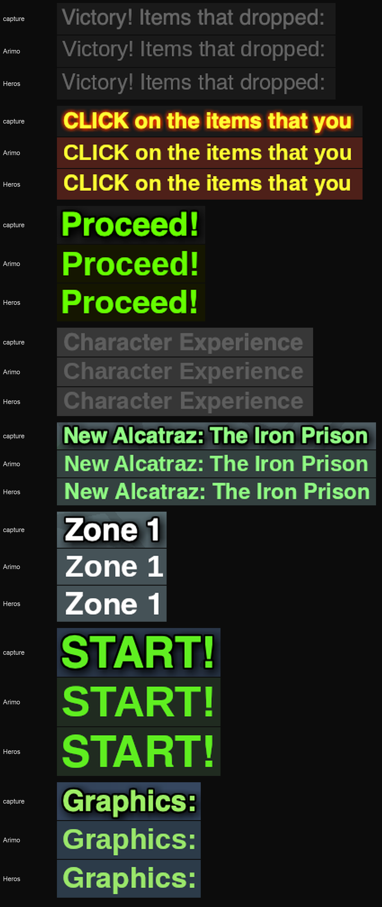
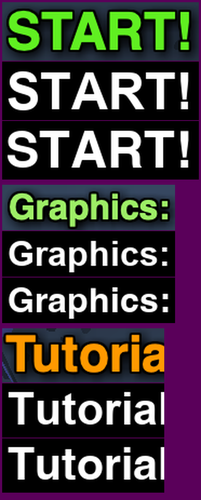

# The measurements behind the `_sans` stand-in font

The renders and numbers behind [Which font should stand in for the original's device _sans?](https://github.com/julian-perge/urchin/issues/118). This branch is throwaway and doesn't get merged.

## Renders

Each capture from `references/2026_07_18_flashpoint/` sits above Arimo and TeX Gyre Heros, rendered through Godot at 2x with the project's `hdr_2d` blending. Only the capture rows have the game's Glow.

The same captures' "START!" and "Graphics:" above Arial Bold and Helvetica Bold at 5x, rendered with Pillow. The capture's R has Helvetica's straight leg, which is a reading by eye. Correlation with the capture favors Helvetica on "START!" (0.874 against 0.855) and ties on "Graphics:" (0.872 against 0.877). The "Tutorial" crop cuts the word, so its correlations mean nothing.

## Numbers

Everything in Godot is 4.7.2 with light hinting and auto subpixel positioning, the project's font import defaults.

Ink width in design px, capture against the Godot render:

| Line | Capture | Arimo | TeX Gyre Heros |
|---|---|---|---|
| Victory! Items that dropped: | 145.0 | 145.5 | 145.5 |
| CLICK on the items that you | 159.5 | 159.5 | 159.0 |
| Proceed! | 74.5 | 74.5 | 74.0 |
| Character Experience | 132.5 | 133.0 | 133.0 |
| New Alcatraz: The Iron Prison | 168.0 | 168.0 | 169.0 |
| Zone 1 | 51.0 | 54.0 | 51.5 |
| START! | 83.5 | 83.5 | 83.5 |
| Graphics: | 73.0 | 73.0 | 73.0 |

Over the 3119 quoted strings in `frame_41/DoAction.as`, at 12 px, against Arial or Arial Bold. The last column counts strings whose line count differs at widths of 146, 166 and 196 px, out of 1352 to 1617 strings that wrap at all. No face is missing a character from those strings.

| Font | Total width against Arial | Line counts that differ |
|---|---|---|
| Arimo Regular | 1.0000 | 0, 0, 0 |
| Arimo Bold | 0.9997 | 4, 1, 1 |
| TeX Gyre Heros Regular | 0.9984 | 12, 11, 9 |
| TeX Gyre Heros Bold | 1.0003 | 15, 10, 4 |

The port's font today, over the same strings at 12 px:

| Measure | Ratio |
|---|---|
| Open Sans SemiBold against Arial | 1.083 |
| Open Sans SemiBold plus `variation_embolden` 1.2 against Arial Bold | 1.048 |
| The embolden on Open Sans SemiBold | 1.038 |
| The embolden on Arial, against Arial | 1.041 |
| The embolden on Arial, against Arial Bold | 0.970 |
| Arial Bold against Arial | 1.073 |

Line counts of the three captured tooltips in Arial, Arimo and TeX Gyre Heros, which all agree with each other. The captures show 11, 5 and 3.

| Tooltip | Clip width less 4 px | Plus one 12 px space (3.34 px) |
|---|---|---|
| Biological blurb | 11 | 11 |
| New Game warning | 5 | 5 |
| Leading Strike | 4 | 3 |

## Scripts

They ran in a scratch Godot project and hardcode the paths of the machine they ran on. `project.godot` copies the port's display settings at a 1600x1200 window.

- `compare.py` measures 13 capture lines against Arial and Helvetica and writes `corpus.txt`.
- `measure.gd` prints every Godot number above, from a headless run.
- `candidates.py prepare` writes `lines.json`, `render.gd` renders it in a window, and `candidates.py compose "Arimo,Heros"` builds the sheet.
- `tell.py` builds the 5x sheet and its correlations.

The four font files they load are `fonts/ttf/` in https://github.com/googlefonts/arimo and `fonts/tex-gyre/opentype/` on https://mirrors.ctan.org, under `downloads/<name>/`.
